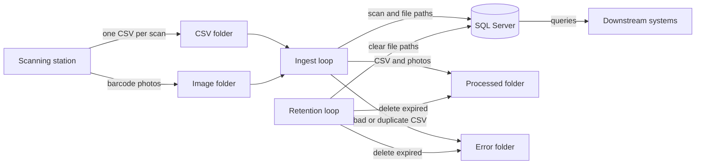

<div align="center">


<h1>Freight Snap Ingest Service</h1>

A Windows Service that picks up the scan files a freight dimensioning and weighing station leaves in a folder,<br>
stores each scan's barcode, dimensions and weight in Microsoft SQL Server, and files the CSV and barcode photos away.<br>
Built by Systems One for sites that need the scan data in a database that other systems can query.

</div>

<p align="center">
  <a href="https://github.com/Systems-One/Freight_Snap_Injest_Service/releases/latest"><b>Latest release</b></a> &middot;
  <a href="#documentation">Documentation</a> &middot;
  <a href="docs/superpowers/specs/2026-08-13-freight-snap-ingest-service-design.md">Design spec</a> &middot;
  <a href="docs/superpowers/plans/2026-08-13-freight-snap-ingest-service.md">Implementation plan</a> &middot;
  <a href="db/schema.sql">Database schema</a>
</p>

## Contents

- [What it does](#what-it-does)
- [What the system can do](#what-the-system-can-do)
- [How it fits together](#how-it-fits-together)
- [Status](#status)
- [Get started](#get-started)
- [Install or deploy](#install-or-deploy)
- [Documentation](#documentation)
- [Repository layout](#repository-layout)
- [Reference](#reference)

## What it does

The scanning station writes one small CSV file per scan (barcode, date and time, length, width, height, volume, weight) and zero or more barcode photos. This service runs unattended on a Windows machine, watches the two folders those files land in, and turns each scan into a database record with its files stored in a tidy archive.

- Every scan becomes one row in SQL Server, with the paths of its CSV and photos.
- The CSV and its photos are moved into one folder per scan, renamed `<Barcode>_<Timestamp>`.
- Photos that arrive after their CSV are waited for, up to a configurable timeout.
- Old files are deleted after a configurable number of days. The scan's measurements stay in the database permanently.
- Other systems read the scans straight from the database. The service has no FTP or API client of its own.

## What the system can do

### Ingest service

Built and covered by automated tests that run in CI on every push and pull request to `main`.

| Area | Capability |
|---|---|
| File pickup | Polls the CSV folder every `PollIntervalSeconds` (default 10). A CSV is read only after its size is unchanged across two consecutive polls, so a file that is still being written is not read. |
| CSV format | Reads a headerless row of 7 comma-separated fields: Barcode, DateTime (`yyyyMMddHHmmss`), Length, Width, Height, Volume, Weight. Blank lines are skipped and the first non-blank row is used. The five measurement fields may be empty. |
| Bad files | A CSV that cannot be parsed is moved to the error folder with a logged reason and is not retried. |
| Photo matching | Finds every file in the image folder whose name contains the barcode, ignoring case, where the barcode is not part of a longer number (barcode `555` does not match a file for `5555`). Zero, one or many photos per scan are accepted. |
| Late photos | A scan with no photos yet stays pending and is re-checked on each poll. After `PendingTimeoutMinutes` (default 30) it is stored without photos. |
| Database write | Inserts one row in `dbo.FreightScans` and one row per photo in `dbo.FreightScanImages` in a single transaction. |
| Archive | Moves the CSV to `<ProcessedDirectory>/<Barcode>_<Timestamp>/<Barcode>_<Timestamp>.csv` and each photo to `<Barcode>_<Timestamp>_<n>` with its original extension, numbered from 1. |
| Failure recovery | If a photo move or the database insert fails, the file moves are undone and the scan is retried on the next poll. One failing file does not stop the rest of the batch. |
| Duplicates | A CSV whose barcode and timestamp were already processed is moved to the error folder instead of being stored again. |
| Retention | Once an hour, processed folders older than `RetentionDays` (default 30) are deleted. Their photo rows are removed and the scan's `CsvPath` is set to NULL first, so a failed pass is repeated safely on the next hour. Error-folder files older than `RetentionDays` are deleted too. The scan row itself is never deleted. |
| Logging | Writes to the console and to a daily rolling log file under `logs/` next to the executable, keeping 30 files. |
| Startup check | Logs the resolved configuration once at start, with the connection string redacted, and warns about any of the four configured folders that does not exist. |

### Delivery

The pipeline is written and has produced one release. The repository has no automated test of the installer itself.

| Area | Capability |
|---|---|
| CI | GitHub Actions builds the solution with warnings as errors and runs the tests on every push and pull request to `main`. |
| Release | A push to `main` that passes the tests publishes a self-contained `win-x64` build, packages it with Inno Setup and attaches `Freight_Snap_Ingest_Service_Setup.exe` to a GitHub Release tagged `vYYYY.MM.DD.<run number>`. |
| Installer | Installs to a folder under Program Files, registers the Windows Service `FreightSnapIngestService` with automatic start and restart on failure (after 5, 10 and 30 seconds), and starts it. Requires administrator rights. |
| Upgrade | Stops and removes the existing service before installing, and keeps an existing `appsettings.json`. |
| Uninstall | Stops and removes the service. `appsettings.json` is left in place. |
| Schema script | `schema.sql` is shipped in the install folder. It creates the two tables only if neither exists. |

## How it fits together



The ingest loop and the retention loop are two independent background workers inside the same Windows Service process.

| Part | What it does | Folder |
|---|---|---|
| Ingest loop | Polls for CSVs, parses them, matches photos, writes to the database and archives the files | [src/FreightSnapIngestService/Ingestion](src/FreightSnapIngestService/Ingestion) |
| CSV parser | Reads the 7-field scan row | [src/FreightSnapIngestService/Csv](src/FreightSnapIngestService/Csv) |
| Photo matcher | Finds the photos that belong to a barcode | [src/FreightSnapIngestService/Images](src/FreightSnapIngestService/Images) |
| File namer | Builds the archive folder and file names | [src/FreightSnapIngestService/Naming](src/FreightSnapIngestService/Naming) |
| Pending tracker | Remembers, in memory, when a scan without photos was first seen | [src/FreightSnapIngestService/Pending](src/FreightSnapIngestService/Pending) |
| Stability tracker | Detects that a file has stopped growing | [src/FreightSnapIngestService/Stability](src/FreightSnapIngestService/Stability) |
| Database access | Inserts scans and clears file paths, using parameterized ADO.NET | [src/FreightSnapIngestService/Db](src/FreightSnapIngestService/Db) |
| Retention loop | Deletes expired output once an hour | [src/FreightSnapIngestService/Retention](src/FreightSnapIngestService/Retention) |
| Configuration | The `FreightIngest` settings section | [src/FreightSnapIngestService/Options](src/FreightSnapIngestService/Options) |
| Host | Wires the parts together and runs as a Windows Service | [src/FreightSnapIngestService/Program.cs](src/FreightSnapIngestService/Program.cs) |
| Database schema | Deployable copy of the two tables | [db/schema.sql](db/schema.sql) |
| Installer script | Inno Setup script used by CI | [setup.iss](setup.iss) |

## Status

| Part | State |
|---|---|
| Ingest and retention service | Built. 51 test methods across 12 test classes (counted in the source, not from a test run), of which 8 run against a real SQL Server instance: 3 repository tests and 5 end-to-end tests. |
| CI | The last run on `main` (2026-08-14) passed and produced the release below. |
| Release | One release so far: `v2026.08.14.2`, published 2026-08-14, with `Freight_Snap_Ingest_Service_Setup.exe` (27.5 MB). |
| Installer | Built by CI. Not covered by any automated test in this repository. |
| Site deployment | Not recorded in this repository. |
| Database schema | `db/schema.sql` is a hand-maintained copy of the schema in `src/FreightSnapIngestService/Db/SchemaSql.cs`. The two must be kept in sync manually. |
| Pending and stability state | Held in memory only. After a service restart a waiting CSV starts its stability check and its photo timeout again. |
| Configuration check | Missing folders produce a warning in the log. The service still starts. |

## Get started

Prerequisites:

- [.NET 8 SDK](https://dotnet.microsoft.com/download/dotnet/8.0)
- A reachable SQL Server instance (LocalDB, Express or full) for the database-backed tests

```bash
dotnet build FreightSnapIngestService.sln
dotnet test FreightSnapIngestService.sln
```

> [!WARNING]
> `dotnet test` connects to a SQL Server instance. By default this is `(localdb)\MSSQLLocalDB`; the `FREIGHT_TEST_SQL_SERVER` environment variable points it at another instance. The tests create and drop their own databases named `FreightSnapIngestTest_<guid>` on that instance, so do not point it at a production server.

> [!WARNING]
> The settings in `src/FreightSnapIngestService/appsettings.json` name real folders under `C:\FreightSnap` and a database called `FreightSnapIngest` on the local default SQL Server instance. Running the service against them moves files out of the incoming folders, and the retention loop deletes processed and error output older than `RetentionDays`.

## Install or deploy

1. Download `Freight_Snap_Ingest_Service_Setup.exe` from the [latest release](https://github.com/Systems-One/Freight_Snap_Injest_Service/releases/latest).
2. Run it as Administrator. It installs to a `Freight Snap Ingest Service` folder under Program Files by default (the installer shows the exact path), registers the Windows Service `FreightSnapIngestService` and starts it. The build is self-contained, so the .NET runtime does not need to be installed.
3. Run `schema.sql` from the install folder against the target SQL Server database, once.
4. Edit `appsettings.json` in the install folder: set the four folders and the connection string in the `FreightIngest` section. The keys are listed under [Configure](#reference) in the Reference section.
5. Restart the service so it reads the new settings: `Restart-Service FreightSnapIngestService`.
6. Check that `Get-Service FreightSnapIngestService` shows `Running` and that the log under `logs/` in the install folder lists your folders without warnings.

Manual publishing without the installer, verification and uninstall steps are in the [Reference](#reference) section.

## Documentation

| I want to | Go to |
|---|---|
| Understand the requirements and design decisions | [Design spec](docs/superpowers/specs/2026-08-13-freight-snap-ingest-service-design.md) |
| See how the service was built, task by task | [Implementation plan](docs/superpowers/plans/2026-08-13-freight-snap-ingest-service.md) |
| Create the database tables | [db/schema.sql](db/schema.sql) |
| See the default settings | [appsettings.json](src/FreightSnapIngestService/appsettings.json) |
| Look up every configuration key | [Reference: Configure](#reference) |
| See how releases are built | [build-and-release.yml](.github/workflows/build-and-release.yml) and [setup.iss](setup.iss) |
| Read the end-to-end test scenarios | [EndToEndIngestionTests.cs](tests/FreightSnapIngestService.Tests/EndToEnd/EndToEndIngestionTests.cs) |
| Check the licence | [LICENSE](LICENSE) |

## Repository layout

| Folder or file | Contents |
|---|---|
| [src/FreightSnapIngestService](src/FreightSnapIngestService) | The Windows Service: .NET 8 worker project, one folder per part, and `appsettings.json` |
| [tests/FreightSnapIngestService.Tests](tests/FreightSnapIngestService.Tests) | xUnit tests that mirror the `src` layout, plus the `EndToEnd` suite |
| [db](db) | `schema.sql`, the deployable SQL Server schema |
| [docs](docs) | Design spec, implementation plan, and the images this README uses in `docs/assets` |
| [Icons](Icons) | `systems_one.ico`, the icon of the executable and the installer |
| [.github/workflows](.github/workflows) | The build, test and release workflow |
| [setup.iss](setup.iss) | Inno Setup installer script |
| [FreightSnapIngestService.sln](FreightSnapIngestService.sln) | Solution containing the service and test projects |
| [LICENSE](LICENSE) | MIT licence |

## Reference

The sections below are the text of the previous README, unchanged.

<details><summary><b>Summary and badges</b></summary>

A Windows Service that ingests CSV scan records and matched barcode images from a freight dimensioning/scale system, writes them to Microsoft SQL Server, organizes the source files into a processed archive, and cleans up expired output on a configurable retention schedule — while keeping every scan's measurement data permanently, even after its files are gone.

[](https://github.com/Jwagener1/Freight_Snap_Injest_Service/actions/workflows/build-and-release.yml) [](https://dotnet.microsoft.com/) [](LICENSE)

</details>

<details><summary><b>Overview</b></summary>

Upstream freight-scanning hardware drops two kinds of files into watch folders: a small CSV per scan (barcode, timestamp, dimensions, weight) and one or more barcode photos. This service:

1. **Polls and parses** incoming CSVs once their size is stable across two consecutive polls (guarding against reading a file mid-write).
2. **Matches** each scan to its barcode photos, waiting up to a configurable timeout for images that arrive slightly after their CSV.
3. **Persists** the scan and its image references to SQL Server in a single transaction.
4. **Archives** the CSV and images into a per-scan processed folder, renamed to a consistent `<Barcode>_<Timestamp>` convention.
5. **Retires** processed and error output after a configurable retention window — deleting files and clearing their database path references, but never the scan's measurement data itself.

Downstream systems (e.g. a WMS) never need FTP/API integration with this service — they simply query the database for scans with live file paths.

</details>

<details><summary><b>Architecture</b></summary>

Two independent `BackgroundService` loops, wired together with dependency injection:

| Component | Responsibility |
|---|---|
| `IngestWorker` | Polls on a configurable interval, driving `IngestPipeline` |
| `IngestPipeline` | Orchestrates: stability check → parse → image match → finalize/rollback |
| `CsvScanParser` | Parses the headerless, positional scan CSV format |
| `ImageMatcher` | Matches barcode photos to a scan via digit-boundary filename matching |
| `ScanFileNamer` | Derives the archived folder/file naming convention |
| `PendingScanTracker` / `FileStabilityTracker` | Time-based state for the poll loop |
| `FreightScanRepository` | Parameterized ADO.NET access to SQL Server |
| `RetentionWorker` | Runs hourly, driving `RetentionCleaner` |
| `RetentionCleaner` | Deletes expired output; clears DB paths first so a transient failure is self-healing |
| `StartupValidation` | Logs resolved configuration and warns on missing directories at boot |

Each collaborator is a small, single-responsibility class with a narrow interface, independently unit-tested. An [automated end-to-end suite](tests/FreightSnapIngestService.Tests/EndToEnd) exercises the real, unfaked pipeline against a real SQL Server instance, using scenarios derived from actual production data samples — including a barcode-substring collision (`555` vs `5555`) that a naive matcher would get wrong.

</details>

<details><summary><b>Prerequisites</b></summary>

- [.NET 8 SDK](https://dotnet.microsoft.com/download/dotnet/8.0)
- A reachable SQL Server instance (LocalDB, Express, or full) for running the database-backed tests and for deployment

</details>

<details><summary><b>Project Structure</b></summary>

```
src/FreightSnapIngestService/
  Csv/          CSV parsing
  Images/       Barcode-to-image matching
  Naming/       Archived file/folder naming
  Pending/      Pending-scan timeout tracking
  Stability/    File-write-stability detection
  Db/           SQL Server schema + repository
  Ingestion/    Pipeline orchestration + polling worker
  Retention/    Cleanup logic + hourly worker
  Options/      Strongly-typed configuration
  Program.cs    DI wiring, Windows Service hosting
tests/FreightSnapIngestService.Tests/
  EndToEnd/     Real-stack tests against a real database
  ...           Unit tests mirroring the src/ layout
db/schema.sql   Deployable SQL Server schema
docs/           Design spec and implementation plan
```

</details>

<details><summary><b>Building and Testing</b></summary>

```bash
dotnet build FreightSnapIngestService.sln
dotnet test FreightSnapIngestService.sln
```

The database-backed tests (repository and end-to-end suites) connect to `(localdb)\MSSQLLocalDB` by default and create/drop their own disposable databases per test run — this matches what's pre-installed on GitHub-hosted Windows runners, so CI works out of the box. To point at a different reachable instance locally (e.g. a full local SQL Server install), set the `FREIGHT_TEST_SQL_SERVER` environment variable to its server name (e.g. `.` for the local default instance) before running `dotnet test`.

</details>

<details><summary><b>Continuous Integration</b></summary>

```
Push to main → [Run Tests] → Pass? → [Build + Package Installer] → GitHub Release
                                ↓ Fail
                            Build blocked
```

Pull requests targeting `main` run the same test job. `main` is protected: merging requires
an open pull request with the test job green — direct pushes and merges with failing or pending
tests are rejected.

</details>

<details><summary><b>Configure</b></summary>

Edit `src/FreightSnapIngestService/appsettings.json` (or an environment-specific override) with real directory paths and connection string before publishing.

The `FreightIngest` section supports the following keys:

| Key                   | Meaning                                                                 | Default |
|------------------------|--------------------------------------------------------------------------|---------|
| `CsvDirectory`         | Folder polled for incoming scan CSV files.                              | —       |
| `ImageDirectory`       | Folder polled for incoming barcode images to match against pending CSVs.| —       |
| `ProcessedDirectory`   | Folder where successfully finalized CSV+image sets are moved.           | —       |
| `ErrorDirectory`       | Folder where malformed or duplicate/re-delivered CSVs are moved.        | —       |
| `PollIntervalSeconds`  | How often the ingest pipeline polls `CsvDirectory` for new files.       | `10`    |
| `PendingTimeoutMinutes`| How long a CSV waits for matching images before finalizing without them.| `30`    |
| `RetentionDays`        | How long processed folders and error files are kept before cleanup.     | `30`    |
| `ConnectionString`     | SQL Server connection string used for `dbo.FreightScans` inserts.       | —       |

`CsvDirectory`, `ImageDirectory`, `ProcessedDirectory`, and `ErrorDirectory` should be
absolute paths. At startup the service logs the resolved configuration once
(with the connection string redacted) and logs a warning for any of these four
directories that doesn't currently exist on disk.

</details>

<details><summary><b>Deploy the Database Schema</b></summary>

Run `db/schema.sql` against the target SQL Server database once, before starting
the service for the first time.

</details>

<details><summary><b>Publish and Install as a Windows Service</b></summary>

### Installer (recommended)

Every push to `main` that passes CI builds `Freight_Snap_Ingest_Service_Setup.exe` and attaches
it to a [GitHub Release](https://github.com/Jwagener1/Freight_Snap_Injest_Service/releases). Run
it as Administrator — it publishes the app, installs it as a Windows Service
(`FreightSnapIngestService`, auto-start with restart-on-failure), and preserves an existing
`appsettings.json` across upgrades. Then apply `db/schema.sql` (included alongside the install)
and edit `appsettings.json` in the install directory as described above.

### Manual

```powershell
dotnet publish src/FreightSnapIngestService -c Release -r win-x64 --self-contained false -o publish

New-Service -Name "FreightSnapIngestService" `
  -BinaryPathName "C:\path\to\publish\FreightSnapIngestService.exe" `
  -DisplayName "Freight Snap Ingest Service" `
  -StartupType Automatic

Start-Service -Name "FreightSnapIngestService"
```

</details>

<details><summary><b>Verify</b></summary>

- `Get-Service FreightSnapIngestService` should show `Running`.
- Drop a CSV into `CsvDirectory` and matching images into `ImageDirectory`; within
  two poll intervals the pair should move to `ProcessedDirectory` and a row should
  appear in `dbo.FreightScans`.
- Logs are written under `logs/` next to the service executable.

</details>

<details><summary><b>Uninstall</b></summary>

```powershell
Stop-Service -Name "FreightSnapIngestService"
sc.exe delete "FreightSnapIngestService"
```

</details>

<details><summary><b>Design Documentation</b></summary>

- [Design spec](docs/superpowers/specs/2026-08-13-freight-snap-ingest-service-design.md) — architecture and requirements
- [Implementation plan](docs/superpowers/plans/2026-08-13-freight-snap-ingest-service.md) — task-by-task build record

</details>

<details><summary><b>License</b></summary>

MIT — see [LICENSE](LICENSE).

</details>
